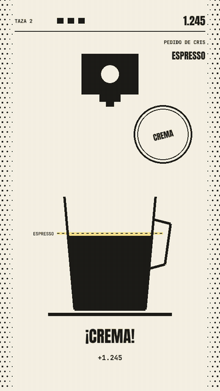

<div align="center">



# Espresso perfecto

The coffee game of [Hot Reload](https://crafter.run/es/events/hot-reload), the Crafter Station meetup.<br>
Hold to pour, release on the line. The coffee keeps falling after you let go, so release early.

**[Play it](https://crafter.run/es/events/hot-reload)** · press <kbd>G</kbd> on the page, or tap "Toca para jugar" on a phone

<a href="https://github.com/crafter-games/dotframe">
  <picture>
    <source media="(prefers-color-scheme: dark)" srcset="https://raw.githubusercontent.com/crafter-games/dotframe/main/assets/badge/made-with-dotframe-dark.svg">
    
  </picture>
</a>

</div>

## How it plays

- Every customer orders a drink: espresso, doble, cortado or latte. Cortados and lattes take a second layer of milk on top.
- Clean cups in a row raise the multiplier from x2 to x4. Three ruined cups and the café closes.
- From the fourth cup on, twists change the pour: a cup moving on a belt, a cup you fill from memory, a cup that leaks.
- At x3 the café goes hot and turns black.

It runs on WebGPU and falls back to Canvas 2D on phones without it. One codebase, one input: hold and release.

## Develop

```sh
bun install
bun run dev        # dotframe dev server
bun run test       # verifies the golden replays in replays/
dotframe build web # hashed bundle in dist/web
```

The game is a deterministic sim (`sim.ts`, `src/game.ts`), so an agent can play it without a screen: `dotframe sim --mash 7 --frames 600 --json` prints the state, and `dotframe snap --frame 300 --mash 7` renders one frame. `replays/shift.json` is a full shift played by a bot: 12 clean cups, 3 spills, 44,297 points.

Sounds are generated with ElevenLabs: delete `assets/sfx/<name>.mp3` and run `bun tools/sfx.ts <name>` with `ELEVENLABS_API_KEY` set.

## Credits

Made by [Crafter Station](https://github.com/crafter-station) for Hot Reload Lima, ed. 01. Fonts and sound credits in [CREDITS.md](CREDITS.md).
